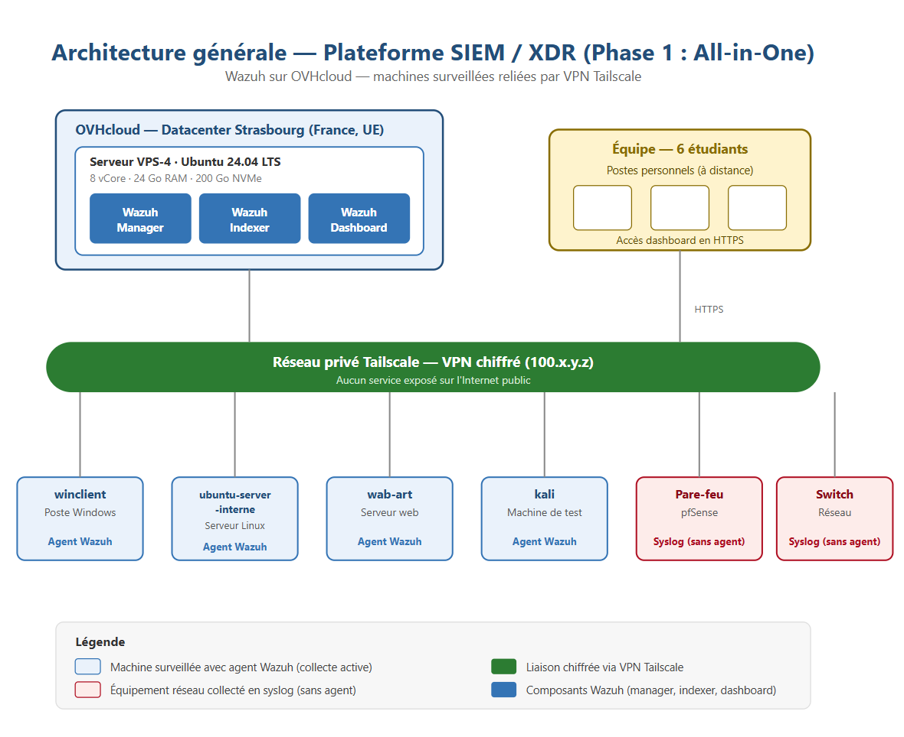

# Aegis - Plateforme SIEM & XDR open-source

Projet de supervision de sécurité réalisé à l'**Efrei Paris** (2025-2026, équipe SR05E) : conception et déploiement d'une plateforme **SIEM** (collecte et corrélation de journaux) et **XDR** (détection sur les postes et serveurs) reposant exclusivement sur des technologies open-source, avec un volet de conformité réglementaire (RGPD, ISO/IEC 27001, PCI DSS).

## Rapport

Le rapport complet est dans [`Rapport final Aegis.pdf`](Rapport-Aegis.pdf).

## Objectifs

- Concevoir et déployer une plateforme SIEM/XDR open-source fonctionnelle.
- Intégrer des sources hétérogènes (postes, serveurs, équipements réseau) et démontrer des cas d'usage de détection.
- Faire évoluer l'architecture d'un modèle centralisé vers un modèle distribué et conteneurisé.
- Assurer la conformité RGPD, puis ISO/IEC 27001 et PCI DSS.

## Choix technologique : Wazuh

Trois solutions de référence ont été comparées : **Wazuh**, **Elastic (ELK)** et **Graylog**. Wazuh a été retenue car elle couvre nativement :

- les fonctions SIEM et XDR (détection sur les endpoints via agents) ;
- le File Integrity Monitoring, la détection de vulnérabilités et la cartographie MITRE ATT&CK ;
- des tableaux de bord de conformité RGPD, ISO/IEC 27001 et PCI DSS intégrés ;
- une mise en oeuvre de complexité moyenne, sans changer d'outil entre les trois phases.

## Architecture

La plateforme est hébergée sur un serveur **OVHcloud VPS-4** (8 vCore, 24 Go de RAM, 200 Go NVMe) au datacenter de Strasbourg (UE), sous **Ubuntu Server 24.04 LTS** avec **Wazuh 4.14**. Les machines surveillées sont reliées au serveur par un VPN chiffré **Tailscale** : aucun service n'est exposé sur l'Internet public.

## Trois phases de maturité croissante

| Phase | Architecture | Mise en oeuvre |
|---|---|---|
| 1 | All-in-One | Installation native de Wazuh (manager, indexeur, dashboard) sur le VPS |
| 2 | Multi-noeuds | Noeuds séparés en conteneurs Docker (manager, indexeur, dashboard) |
| 3 | Cluster | Cluster et load balancing conteneurisés, option Kubernetes managé OVH |

## Sources surveillées

| Agent | Type de système | Mode de collecte |
|---|---|---|
| winclient | Poste Windows | Agent |
| ubuntu-server-interne | Serveur Linux | Agent |
| wab-art | Serveur web | Agent |
| kali | Machine de test / attaquant | Agent |
| Pare-feu, switch | Équipements réseau | Syslog sans agent (à intégrer) |

## Cas d'usage de détection démontrés

- **Brute force** : attaque SSH, règle de détection personnalisée, alerte sur le tableau de bord et par e-mail.
- **File Integrity Monitoring** : modification d'un fichier critique factice et alerte d'intégrité de niveau élevé.
- **Processus suspect** : recherche d'informations sensibles ou usage d'outils de hacking, détectés par Wazuh.
- **MITRE ATT&CK** : détections cartographiées (Valid Accounts, Password Guessing, Brute Force, SSH) dans le tableau de bord Threat Hunting.

## Conformité réglementaire

La conformité est le fil rouge du projet : socle **RGPD** dès la phase 1, renforcé par **ISO/IEC 27001** (phase 2) puis **PCI DSS** (phase 3).

- **RGPD** : finalité et base légale (intérêt légitime, art. 6.1.f), minimisation des données (adresse IP, nom d'utilisateur, nom de machine, horodatage), contrôle d'accès par rôles (RBAC) avec comptes nominatifs, chiffrement TLS, rétention limitée, hébergement en UE, analyse de risque simplifiée.
- **ISO/IEC 27001** : mesures rattachées aux contrôles A.9 (accès), A.10 (cryptographie), A.12.4 (journalisation, horodatage NTP) et A.18 (conformité), avec preuves.
- **PCI DSS 10.5.1** : rétention à deux niveaux (90 jours en accès immédiat, puis archivage en stockage froid jusqu'à 12 mois).

## Points à noter

- Le tableau de bord utilise un certificat auto-signé généré par Wazuh, d'où l'avertissement « Non sécurisé » du navigateur.
- La collecte syslog des équipements réseau était prévue mais non finalisée au moment du rapport.

## Technologies

Wazuh (manager, indexeur, dashboard), Docker, Tailscale, OVHcloud, Ubuntu Server, MITRE ATT&CK, Git.
